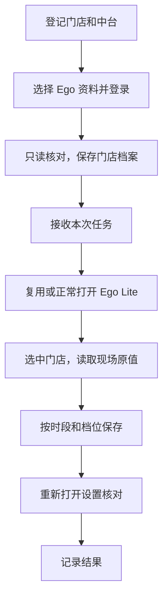

# 脚本怎样工作

## 选店和并行

每次先打开商家首页，从美团的选店入口进入目标门店，再从当前菜单打开配送设置。门店档案保存账号、时段、范围和用户备注，价格以每次现场读到的值为准。

同一 Ego 资料的多个空间共享选店状态。实测中，一处切店后，另一处仍显示原门店名和 ID，却能读到新选门店的价格。单店和批量命令因此都按 Ego 资料和美团账号限制同机重叠操作，包括只读核对。资料和账号都不同的批次可以并行。同一资料里的手动切店同样会影响页面。

## 保存和核对

- 起送价在同一个时段内集中填好后保存。基础配送费按美团页面要求逐档确认。
- 每个保存步骤记录表单结果和页面反馈。同一价格字段改完后，重新打开设置页，比较该页全部时段、档位、价格和加价摘要。
- 手动时段的开关从配送信息总览读取。保存后重载总览，核对开关，并记录页面显示的生效状态和关闭时间。
- 单按钮的「我知道了」提示直接关闭。浏览器确认框属于当前保存步骤时继续处理，之后仍核对实际值。需要判断的弹窗会把正文和空间 ID 带回，便于回到原页面处理。
- 保存或核对结果不明确时，把待核实状态记在本次任务里。根据实际值决定下一步。

## 本地记录

| 文件 | 内容 |
| --- | --- |
| `.local/stores.json` | 门店清单及 Ego 资料 |
| `.local/store-profiles/<门店ID>.json` | 只读建档结果和备注 |
| `before.json` | 本次操作前读到的值 |
| `001.json` 等编号文件 | 各次保存的原值、目标、时间、页面反馈和读数 |
| `minOrder-readback.json`、`baseFee-readback.json` | 重新打开价格页后的完整读数 |
| `summary.json`、`batch-summary.json` | 状态、明细路径和耗时 |

运行记录都在 `.local/runs/`。单店摘要分别记录选店、读取、保存和重新打开核对的时间。
